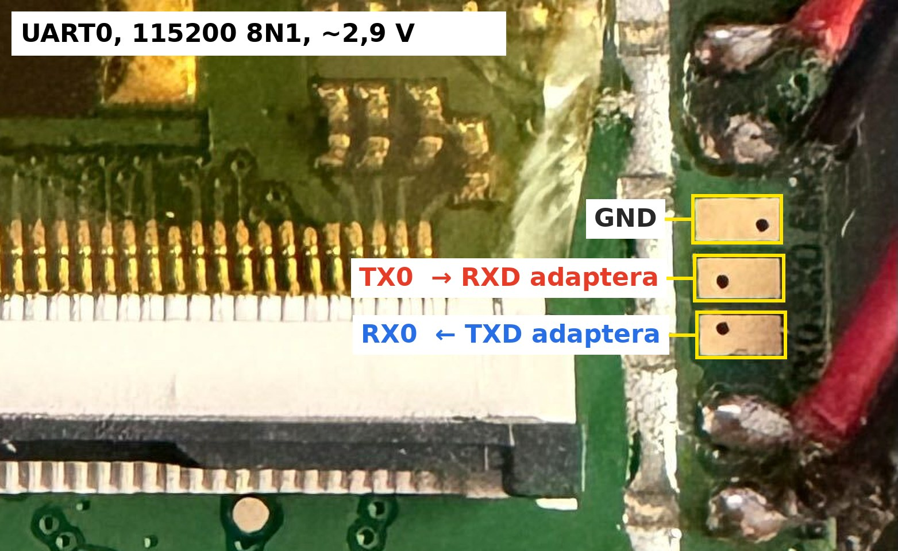

# Linux dla GoClever Navio 505

Port **Linuksa 6.12** na nawigację GoClever Navio 505 z układem
**MStar MSB2521 U03** (ARM926EJ-S). Zamiast Windows CE uruchamia się
minimalny Linux z powłoką BusyBox. Na LCD widać konsolę, polecenia wpisuje
się przez UART, a przycisk Power wyłącza urządzenie.

```text
NAVIO 505 LINUX 6.12.0-navio505-1.0
LCD shell 60x17; type on UART 115200 8N1
Hold Power 1 s or run poweroff to switch off

NAVIO SHELL: BusyBox ash; input UART, output UART + LCD; exit respawns.
navio# uname -r
6.12.0-navio505-1.0
```

Obraz startuje przez fabryczny bootloader EBOOT, więc programator pamięci
nie jest potrzebny. Wystarczą karta SD i adapter USB‑UART (CP2102)
podłączony do padów UART0 na płytce. Najpierw uruchamia się Linuksa z karty,
w RAM, bez zmian w urządzeniu. Instalacja do pamięci NAND jest osobnym,
świadomym krokiem.

## Co działa

| Funkcja | Stan |
|---|---|
| Start z karty SD (RAM, EBOOT `D`) i z NAND bez karty (EBOOT `X`) | ✅ |
| Konsola na LCD 480×272 (fbcon 60×17) | ✅ |
| Powłoka BusyBox `ash` przez UART0 115200 8N1 | ✅ |
| Przerwania, timery, zegar systemowy | ✅ |
| Przycisk Power: przytrzymanie 1 s wyłącza, ponowne naciśnięcie włącza | ✅ |
| `poweroff`; z zasilaczem przejście w tryb ładowania EBOOT | ✅ |
| Ekran dotykowy, przyciski poza Power | ❌ brak sterownika |
| Karta SD w Linuksie, NAND/MTD, USB, dźwięk, GPS | ❌ brak sterownika |
| `reboot`, zegar RTC (czas startuje od 1970) | ❌ |
| Trwały system plików | ❌ tylko initramfs w RAM |

Obsługiwany jest **wyłącznie** egzemplarz z EBOOT *MStar Columbus 0.1104*
i SoC *MSB2521 U03*. Sprawdzisz to w logu UART (krok 3). Inne modele
GoClever, np. Navio 5055, mogą mieć inny układ. Nie zakładaj zgodności.

## Ostrzeżenia

- **Instalacja w NAND (krok 6) kasuje Windows CE** i jego partycje danych
  w pamięci wewnętrznej. Powrót do CE jest możliwy tylko z oryginalnym
  plikiem `xip.bin` z karty nawigacji (zob. [Powrót do Windows CE](#powrót-do-windows-ce)).
- Zanim cokolwiek zmienisz, **skopiuj całą zawartość karty SD na komputer**.
- Bootloadera (bloki 0–53 NAND) nie trzeba ruszać i ten projekt tego nie robi.
  W menu EBOOT używaj wyłącznie opcji opisanych poniżej. `0`, `1`, `2`, `G`,
  `C` i `R` zapisują lub kasują NAND albo konfigurację.
- Projekt jest hobbystyczny. Używasz go na własne ryzyko.

## Czego potrzebujesz

- GoClever Navio 505 (MSB2521 U03, EBOOT 0.1104).
- Adapter USB‑UART **3,3 V**, np. CP2102, podłączony do UART0 nawigacji:
  [docs/uart-cp2102.md](docs/uart-cp2102.md).
- Kartę SD sformatowaną jako **FAT16**. Najprościej użyć oryginalnej karty
  nawigacji.
- Komputer z Linuksem (testowano na Ubuntu 22.04): `make`, `gcc`, `flex`,
  `bison`, `bc`, `patch`, `python3`. Do testów emulatora: `pip install unicorn`.
- Około 2,5 GB miejsca na dysku. Toolchain i źródła pobierają się same.

```sh
sudo apt install build-essential flex bison bc patch python3 xz-utils bzip2
python3 -m pip install --user -r requirements-dev.txt   # opcjonalnie, do make test
```

## Instrukcja

### 1. Zbuduj obraz

```sh
git clone https://github.com/szelep/navio-505-linux.git
cd navio-505-linux
make fetch   # pobiera Linux 6.12, BusyBox 1.37.0 i toolchain Bootlin; sprawdza SHA256
make         # BusyBox → initramfs → jądro → out/NK.nb0
make test    # testy hosta i emulatora (opcjonalnie)
```

Wynik znajdziesz w katalogu `out/`:

| Plik | Do czego |
|---|---|
| `out/NK.nb0` | obraz B000FF dla EBOOT, używany przez D i X |
| `out/flat-image.bin` | ten sam obraz w postaci płaskiej, do porównania z NAND |
| `out/manifest.json`, `out/SHA256SUMS` | sumy i adresy |

### 2. Podłącz UART

Trzy pady UART0 (GND, TX0, RX0) są na prawej krawędzi płyty głównej, obok
złącza taśmy FPC:



TX0 podłącz do RXD adaptera, RX0 do TXD (najlepiej przez 1 kΩ), a GND do GND.
Pinu zasilania adaptera nie podłączaj. Szczegóły i pomiar kontrolny:
[docs/uart-cp2102.md](docs/uart-cp2102.md). Następnie ustal stałą ścieżkę
adaptera:

```sh
ls -l /dev/serial/by-id/
PORT=/dev/serial/by-id/usb-Silicon_Labs_CP2102_..._port0   # wstaw swoją
```

Nie uruchamiaj jednocześnie dwóch programów korzystających z tego portu.

### 3. Sprawdź, czy to właściwe urządzenie

```sh
tools/navio-uart.py --port $PORT monitor
```

Krótko naciśnij **RESET** z tyłu nawigacji. W logu powinny pojawić się
linie:

```text
Microsoft Windows CE Bootloader for MStar Columbus Version 0.1104 Built May  2 2012
***** MSB2521 U03 Device *****
```

Zakończ monitor klawiszami Ctrl‑C. Przy innej wersji EBOOT przerwij
w tym miejscu.

### 4. Przygotuj kartę SD

Włóż kartę do komputera i najpierw skopiuj całą jej zawartość w bezpieczne
miejsce. Następnie sprawdź, co EBOOT zobaczy na karcie:

```sh
scripts/stage-sd.py check --card /media/$USER/NAZWA_KARTY
```

Skrypt wymaga FAT16. Jeśli karta ma FAT32, skopiuj z niej pliki, utwórz
partycję FAT16 (najwyżej 2 GB, np. `sudo mkfs.fat -F 16 /dev/sdX1`,
**to kasuje kartę**) i przywróć pliki.

Umieść obraz na karcie do próby w RAM:

```sh
scripts/stage-sd.py ram --card /media/$USER/NAZWA_KARTY
```

Skrypt:

- sprawdza, że karta ma FAT16, a w katalogu głównym nie ma pliku `UPD`;
- odczytuje prawdziwe krótkie nazwy 8.3 i odmawia działania, gdy do `NK.NB0`
  pasuje więcej niż jeden plik. Komparator nazw w EBOOT jest luźny, więc np.
  `NK.original.nb0` też pasuje (szczegóły:
  [docs/porting-notes.md](docs/porting-notes.md#wybór-pliku-na-karcie-przez-eboot));
- kopiuje zastępowany `NK.nb0` do `backups/<data>/` na komputerze;
- zapisuje obraz, wykonuje fsync i porównuje SHA256.

Odmontuj kartę i włóż ją do nawigacji.

### 5. Uruchom Linuksa z karty (RAM, bez zmian w NAND)

Zostaw podłączone zasilanie i uruchom:

```sh
tools/navio-uart.py --port $PORT ram-boot
```

Gdy narzędzie poprosi, krótko naciśnij **RESET**. Narzędzie przerwie
odliczanie EBOOT spacją, sprawdzi, że wyświetliło się pełne menu, i wyśle `D`.
EBOOT wczyta `NK.nb0` z karty do RAM. Po kilku sekundach na LCD pojawi się
konsola Linuksa, a w terminalu znak zachęty `navio#`. Prawidłowy start
wygląda w logu tak:

```text
INFO: OEMLaunch: Jumping to Physical Address 0x20300000h (Virtual Address 0x80300000h)...
NAVIO LINUX HANDOFF v5: raw Image, image base 20300000
...
WXYZJABCDEFBooting Linux on physical CPU 0x0
Linux version 6.12.0-navio505-1.0 ...
OF: fdt: Machine model: GoClever Navio 505 (MStar MSB2521 U03)
MSB2521 legacy IRQ controller at a0005600
simple-framebuffer 20100000.framebuffer: fb0: simplefb registered!
Run /init as init process
NAVIO LINUX INITRAMFS v5: shell on pty, UART input, UART + LCD output; RAM only
navio#
```

Powłoka:

```sh
tools/navio-uart.py --port $PORT shell             # interaktywnie, Ctrl-] kończy
tools/navio-uart.py --port $PORT shell -c 'uname -a' -c 'free'
```

Klawiatura w `shell` jest zablokowana, dopóki narzędzie nie zobaczy świeżego
`navio#`. Gdy na linii pojawi się EBOOT (np. po RESET), blokuje się ponownie,
więc wpisywany tekst nie trafi do menu bootloadera.

Kolejny RESET przywraca system zapisany w NAND, czyli nadal Windows CE.
Ten krok niczego nie zmienia w urządzeniu.

### 6. (Opcjonalnie) zainstaluj w NAND

Wykonuj ten krok tylko wtedy, gdy krok 5 zadziałał i chcesz, żeby Linux
startował bez karty. **Windows CE zostanie skasowany.**

```sh
scripts/stage-sd.py nand --card /media/$USER/NAZWA_KARTY
```

Skrypt zapisuje obraz także jako `XIP.BIN`. Oryginalny `xip.bin` (Windows CE)
kopiuje najpierw do `backups/<data>/`. **Zachowaj ten plik**, bo bez niego
nie wrócisz do CE. Włóż kartę do nawigacji:

```sh
tools/navio-uart.py --port $PORT nand-install --erase-nand
```

Po RESET i potwierdzeniu wpisem `ERASE` narzędzie wyśle `X`. EBOOT skasuje
NAND od bloku 54, zapisze obraz, ustawi konfigurację startu i uruchomi
Linuksa. **Nie wyjmuj karty i nie naciskaj RESET, dopóki nie zobaczysz
`navio#`.** Jeśli zapis zostanie przerwany, EBOOT nadal działa
(bloki 0–53 są nietknięte). Wtedy powtórz X z poprawną kartą.

Sprawdzenie zapisu i startu:

```sh
tools/navio-uart.py --port $PORT nand-verify   # ~20 stron, ok. 6 minut
```

Pełny odczyt (`--all`) trwa około 4 godzin (16 s na stronę). Na koniec wyjmij
kartę i naciśnij RESET: Linux powinien wystartować z NAND.

## Obsługa

- **Wyłączanie:** przytrzymaj Power przez około 1 s albo wpisz `poweroff`.
  - Na baterii urządzenie wyłącza się całkowicie. Krótkie naciśnięcie
    Power je włącza.
  - Z podłączonym zasilaczem lub USB urządzenie przechodzi w tryb ładowania
    EBOOT (ciemny ekran). Aby je włączyć, przytrzymaj Power przez **2–3 s**.
- Krótkie naciśnięcie Power w Linuksie jest ignorowane.
- `reboot` nie jest obsługiwany. Użyj RESET z tyłu obudowy.
- System działa w RAM. Zmiany w plikach znikają po wyłączeniu.

## Powrót do Windows CE

Potrzebujesz oryginalnego `xip.bin`, który `stage-sd.py nand` zapisał
w `backups/<data>/`:

```sh
scripts/stage-sd.py restore --card /media/$USER/NAZWA_KARTY --backup backups/<data>
tools/navio-uart.py --port $PORT nand-install --erase-nand --no-wait
```

EBOOT zapisze wtedy Windows CE z przywróconego `xip.bin`. Gdy CE wystartuje,
zakończ monitor klawiszami Ctrl‑C. Partycje danych CE
zostały wcześniej skasowane, więc aplikacje producenta trzeba zainstalować
ponownie z karty nawigacji.

## Jak to działa

```text
EBOOT 0.1104 ──D/X──► NK.nb0 (B000FF) ──► 0x20300000 skok
                                           0x20301000 handoff (boot/)
                                           0x20310000 DTB
                                           0x20408000 Linux Image + initramfs
```

- EBOOT inicjalizuje DRAM, zegary, LCD i podświetlenie. Linux z tego korzysta
  i nie przeprogramowuje PLL ani kontrolera LCD. Rysuje w buforze, który
  EBOOT zostawił pod `0x20100000` (`simple-framebuffer`).
- Mały **handoff** w `boot/` sprawdza stan CPU, unieważnia I-cache i skacze
  do jądra z adresem DTB w `r2`.
- Obsługę płyty w `kernel/arch/arm/mach-msb2521/` stanowią kontroler
  przerwań, timery, konsola i PMU (przycisk Power, wyłączanie). Rejestry
  odtworzono z firmware producenta.

Szczegóły (mapa pamięci, format B000FF, działanie opcji X, wybór pliku przez
EBOOT, rejestry): [docs/porting-notes.md](docs/porting-notes.md).

## Struktura repozytorium

```text
kernel/
  arch/arm/mach-msb2521/   board.c, power.c, Kconfig, Makefile (GPL-2.0-only)
  patches/                 podpięcie maszyny i znaczniki startu w head.S
  navio505.dts             device tree
  navio505_defconfig       konfiguracja jądra
boot/                      handoff EBOOT → Linux (ARM, 752 B)
rootfs/init.c              PID 1: powłoka na pty, lustro UART → LCD, poweroff
scripts/                   fetch, build-*, package, check-b000ff, stage-sd
tools/navio-uart.py        UART: monitor, menu, ram-boot, nand-install, shell, nand-verify
tests/                     test-init (host), test-offline (emulator ARM926)
docs/                      notatki z portu, podłączenie UART
```

## Rozwój

```sh
make                       # po każdej zmianie w kernel/, boot/ lub rootfs/
make test                  # zawsze przed próbą na sprzęcie
make test EBOOT=/ścieżka/EBOOT-0.1104.nb0   # dodatkowo prawdziwy parser EBOOT
```

Nazwę wersji ustawia `CONFIG_LOCALVERSION` w `kernel/navio505_defconfig`.

`make test` obejmuje dwa zestawy testów:

- `tests/test-init.py` kompiluje `init.c` natywnie i sprawdza na
  pseudoterminalach przekazywanie znaków, rozmiar okna LCD, Ctrl‑C,
  ponowne uruchamianie powłoki i `poweroff`.
- `tests/test-offline.py` emuluje ARM926 (Unicorn) i sprawdza strukturę
  B000FF, handoff wraz z jego warunkami odmowy oraz skompilowane funkcje
  jądra: maski IRQ, programowanie timerów, sekwencje PMU i obsługę
  przycisku. Z opcją `EBOOT=` uruchamia też oryginalny parser EBOOT na
  `NK.nb0`. Wymaga to własnego zrzutu bootloadera; repozytorium nie zawiera
  kodu producenta.

Emulator sprawdza ścieżki kodu, ale nie zastępuje próby na urządzeniu.
Nowy obraz zawsze uruchom najpierw w RAM (krok 5).

Najbliższe cele: sterownik SD (kontroler FCIE3), dzięki któremu można by
montować kartę i aktualizować system bez UART, oraz obsługa ekranu dotykowego.

## Status wersji

| Wersja | Zawartość | Weryfikacja |
|---|---|---|
| **1.0** (`6.12.0-navio505-1.0`) | to repozytorium | build i testy offline PASS |

Kod 1.0 pochodzi z buildu rozwojowego, który przeszedł na urządzeniu próbę
RAM, instalację w NAND, start bez karty oraz testy przycisku Power
i wyłączania na baterii i z zasilaczem. Różni się od niego tylko nazwą
wersji, opisem modelu w DT i włączoną opcją `CONFIG_POSIX_TIMERS`, którą
sprawdzono na sprzęcie w późniejszym buildzie. Handoff i `init` kompilują
się do identycznych plików binarnych. Samego obrazu 1.0 nie uruchamiano
jeszcze na sprzęcie. Krok 5 pozwala sprawdzić go bezpiecznie.

## Autorzy

Autor: Konrad Szelepusta. Port powstał we współpracy z
[Claude](https://claude.ai) (Anthropic). Asystent AI pomagał w analizie
firmware, pisaniu kodu, testach i dokumentacji. Próby na urządzeniu
wykonywano na prawdziwym Navio 505.

## Licencja

Kod jądra (`kernel/`) jest objęty licencją GPL-2.0-only
([LICENSES/GPL-2.0-only.txt](LICENSES/GPL-2.0-only.txt)), a pozostałe pliki
licencją MIT ([LICENSE](LICENSE)). Linux, BusyBox i toolchain Bootlin
pobierane są z oficjalnych źródeł i mają własne licencje.
