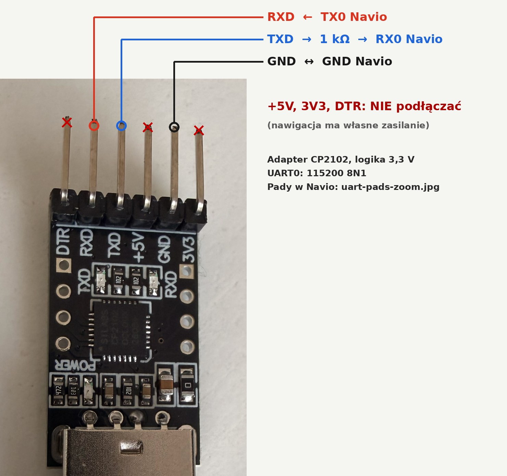
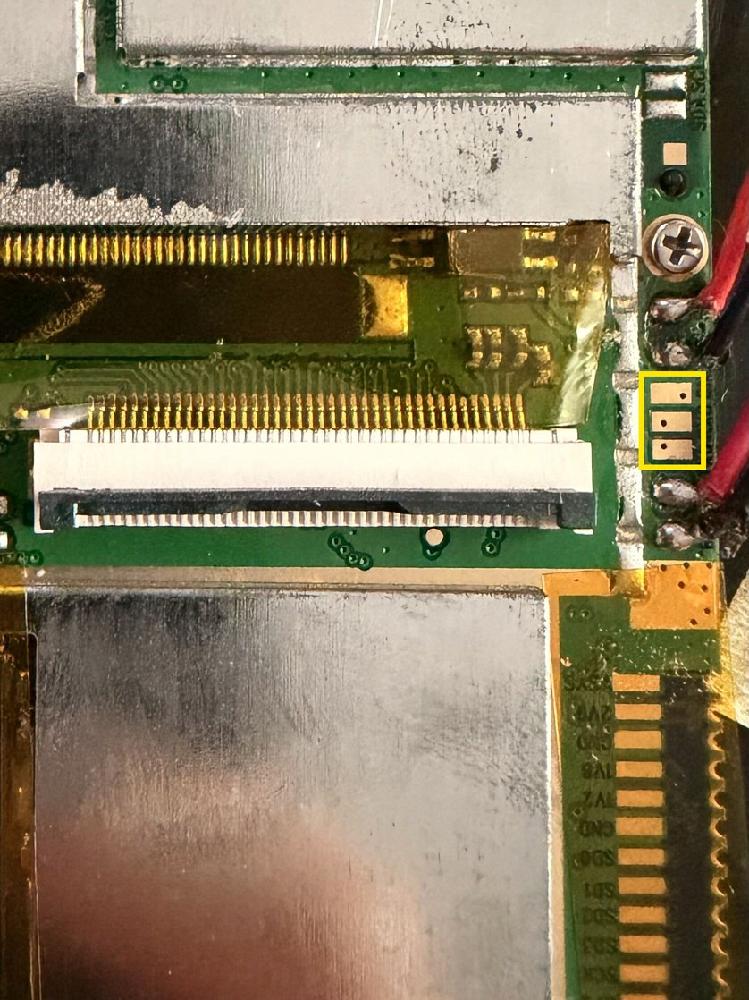

# Podłączenie adaptera USB‑UART (CP2102)

Cała instalacja wymaga dostępu do UART0 nawigacji: tam działa menu EBOOT
i konsola Linuksa. Wystarczy tani adapter na CP2102 (albo CH340/FT232)
pracujący w logice **3,3 V**.

## Połączenie

```text
 Navio 505 (UART0, logika ~2,9 V)         adapter CP2102 (3,3 V)
 ─────────────────────────────────        ───────────────────────
 TX0  ──────────────────────────────────►  RXD
 RX0  ◄────────────[ 1 kΩ ]──────────────  TXD
 GND  ───────────────────────────────────  GND
                                            3V3 / 5V  ── NIE podłączaj
```



Na zdjęciu typowy moduł CP2102 z wyprowadzeniami DTR, RXD, TXD, +5V, GND
i 3V3. Podłączasz tylko **RXD, TXD i GND**
([zdjęcie bez opisów](images/uart-adapter-photo.jpg)).

- TX i RX są **skrzyżowane**, a masa jest wspólna.
- Nie zasilaj nawigacji z adaptera. Pin VCC/3V3/5V zostaw wolny.
- Linie I/O Navio pracują przy około 2,9 V (domena `VDD_VPER1` MSB2521).
  Wyjście Navio (~2,8–2,9 V) adapter 3,3 V odczyta bez problemu.
  Podczas rozwoju portu adapter CP2102 3,3 V był podłączony do Navio
  bezpośrednio. Rezystor szeregowy 1 kΩ w kierunku do Navio to dodatkowe
  zabezpieczenie, bo ogranicza prąd płynący przez diody chroniące wejście.
  Najbezpieczniejszy jest konwerter poziomów 3,3 V ↔ 2,9 V.
  **Nigdy nie używaj adaptera 5 V.**
- Parametry: **115200 8N1**, bez kontroli przepływu.

## Gdzie są pady

Trzy kwadratowe pady UART0 leżą na prawej krawędzi płyty głównej, obok
dużego złącza taśmy FPC. Opis na sitodruku jest obrócony o 90°. Od góry
(w orientacji zdjęcia) kolejność to **GND, TX0, RX0**:


<details>
<summary>Położenie na płytce (całe zdjęcie)</summary>



Pełna rozdzielczość: [images/uart-pads-photo.jpg](images/uart-pads-photo.jpg).
</details>

| Pad (od góry) | Sygnał | Do adaptera |
|---|---|---|
| 1 | GND | GND |
| 2 | TX0 (wyjście Navio) | RXD |
| 3 | RX0 (wejście Navio) | TXD (przez 1 kΩ) |

Chodzi o trzy kwadratowe pady. Nie myl ich z okrągłymi padami powyżej
i poniżej, do których na zdjęciu przylutowane są przewody.

Sitodruk jest drobny, więc przed lutowaniem potwierdź pady pomiarem:

1. Odłącz akumulator, czyli 2‑pinową wtyczkę na płytce.
2. Multimetrem w trybie ciągłości sprawdź, że pad GND ma połączenie
   z masą, np. z ekranem gniazda USB.
3. Podłącz akumulator i włącz urządzenie. Względem GND na TX0 powinno być
   ok. 2,9 V, z wahaniami w pierwszych sekundach startu, gdy bootloader
   dużo wypisuje. RX0 ma stały stan wysoki.
4. Najpierw podłącz tylko TX0 i GND, a potem uruchom
   `tools/navio-uart.py monitor`. Po RESET powinien pojawić się tekst EBOOT.
   Dopiero wtedy dołącz RX0 przez rezystor.

## Identyfikacja urządzenia i portu

Numery `/dev/ttyUSB*` zmieniają się po każdym podłączeniu. Używaj stałej
ścieżki:

```sh
ls -l /dev/serial/by-id/
# np. usb-Silicon_Labs_CP2102_USB_to_UART_Bridge_Controller_0001-if00-port0
```

Na port musisz mieć uprawnienia. Na Debianie i Ubuntu dodaj się do grupy
`dialout` (`sudo usermod -aG dialout $USER`, potem wyloguj się i zaloguj
ponownie).

Podczas pracy z portem może działać **tylko jeden program**, który go
otwiera. Zamknij `picocom`, `minicom` i inne monitory, zanim uruchomisz
`navio-uart.py`. Narzędzie otwiera port na wyłączność (`TIOCEXCL`).

Właściwy układ rozpoznasz w logu EBOOT po RESET:

```text
Microsoft Windows CE Bootloader for MStar Columbus Version 0.1104 Built May  2 2012
***** MSB2521 U03 Device *****
```

Jeśli widzisz inną wersję EBOOT lub inny SoC, nie instaluj obrazu do NAND.
Adresy i układ obrazu zostały ustalone tylko dla tej wersji.
